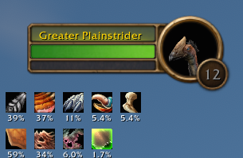
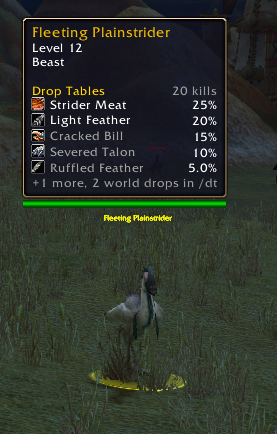
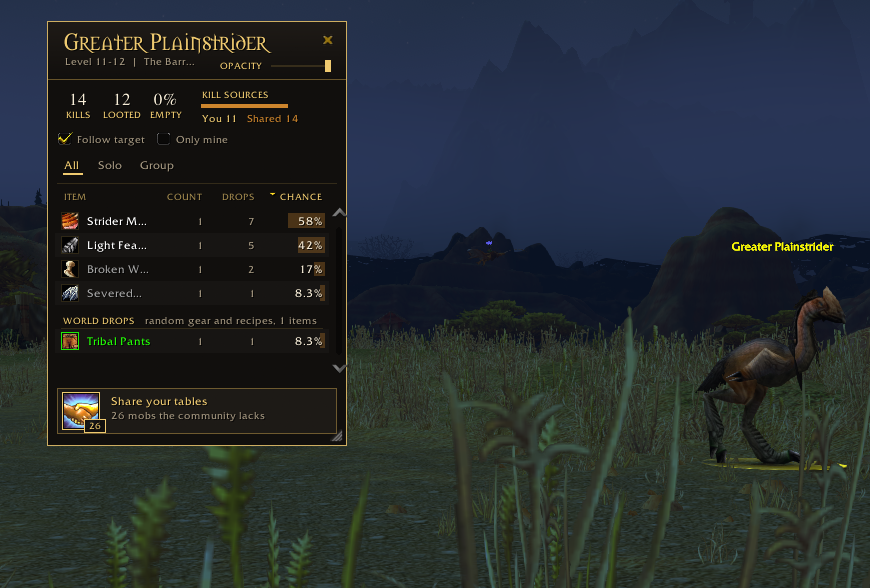
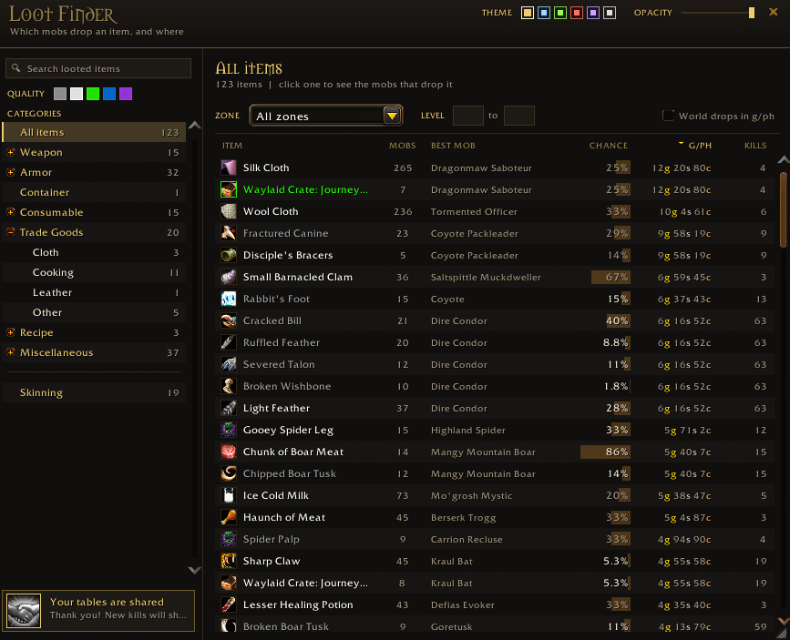

# Forever Drop Tables

Forever Drop Tables is a World of Warcraft: Forever addon that records what drops from the mobs you kill and shows the drop chances in game.

This is an early test build, so expect bugs. At first the tables only know your own kills. If other players run the addon too, they can fill the gaps: when you target a mob you know little about, the addon asks them, and their counts show up in your tables next to yours. You can also copy an export out of the game and send it from a web page. Everything sent there goes into a shared database that comes with the addon, so a new install already has chances for mobs you've never killed.

## Download

The latest version is here: https://github.com/valcheffnet/DropTables/releases/latest

Under Assets, download `DropTables-x.y.z.zip`. The Source code archives are not the addon.

## Screenshots

Target a mob and its likely drops show up as icons under the target frame, each with its chance. If you can skin it, a second row underneath shows what skinning gives.

Mouse over a mob and its tooltip lists what it drops and how often, with skinning on a line of its own.

The drop table window follows your target and shows where the kills behind each chance came from. The Price column is what each item is worth in the gold per hour.

The Loot Finder works the other way round. Its item list shows the best mob for each item, the one that brings the most gold an hour, and clicking an item lists every mob that drops it with its zone and chance. The search box finds mobs as well: type part of a name and they show up under Mobs, where a click opens the mob's drop table. The boxes above the list narrow it down by zone, level, kills and chance.

## Install

1. Close the game.
2. Unzip the file into `World of Warcraft\_forever_\Interface\AddOns\`. You should end up with `Interface\AddOns\DropTables\DropTables.toc`. If you get `DropTables\DropTables\DropTables.toc`, move the inner folder up one level.
3. Start the game and check that Drop Tables is enabled in the AddOns list on the character screen.

To update, delete the old `DropTables` folder and unzip the new one. Your recorded drops live in the WTF folder, so updating doesn't touch them.

## Using it

The addon starts with an empty table and fills it as you kill and loot. Target or mouse over a mob and its most likely drops show up under the target frame and in its tooltip. The minimap button opens the loot finder on left click and a menu on right click. The table window shows how many kills are yours and how many came from other players, and Only mine hides theirs. Their counts go straight into the chances together with yours, and a chance from fewer than 10 looted corpses shows in grey. If you'd rather the addon didn't talk to other players at all, turn off Share with other players in the options. /dt export and the shared database still work.

Skinning is counted apart from the loot, per skinned corpse, since every skin gives something. The drop table window shows it in a section of its own, the tooltip on a line of its own, and the Loot Finder in its own category, where each leather lists the mobs that give it with the Skinning skill they need.

The g/ph column in the Loot Finder says roughly what farming a mob is worth in an hour. It takes auction prices from Auctionator, FojjiCore or TradeSkillMaster if you have one of them, in that order, the vendor price otherwise, and the kills per hour from the options. A mob gets one only after 10 looted corpses, since a lucky drop in the first few can make it look worth far more than it is.

Commands (`/droptables` works too):

- `/dt` opens or closes the drop table window, on your target if you have one
- `/dt find` opens the loot finder, and `/dt find linen` searches for linen straight away (a mob's name works too)
- `/dt options` (or `/dt config`) opens the settings. Restore defaults at the bottom puts every setting and window back the way it was on first install.
- `/dt unlock` lets you drag the icons under the target frame somewhere else, `/dt lock` fixes them in place again. Blizzard's Edit Mode does the same.
- `/dt reset` puts the icons back under the target frame
- `/dt icons`, `/dt tooltip` and `/dt minimap` turn the icons, the tooltip lines or the minimap button on and off
- `/dt export` opens the window with the text to share (see below)
- `/dt status` shows how many mobs and kills you have recorded, what other players have sent you and how many of your mobs have new counts to share

## Sharing your tables

The shared database only grows when players send their tables in. Type `/dt export`, or click the share card at the bottom of the Loot Finder or the drop table window, then press Select and Ctrl+C in the window. Open the share page under the text, paste it there and press Send. You don't need an account for it. The export holds everything of yours that the shared database doesn't have yet, plus what other players sent you, so if you copy it and forget to send it, it's still there the next time. A big table can come out in several parts, and you send each part by itself. The page files it on GitHub, where a bot checks it and adds it to the shared database, usually within a few minutes. Players get the new counts with the next release of the addon.

Every export ends with a key that only your install knows. The share page keeps the key out of the public issue and writes down only a hash of it, and once one of your exports has come in that way, only exports with the same hash count as yours, so nobody else can send counts in your install's name. The share page also turns away an export from an older version of Drop Tables and asks you to update and export again, since the old version may still have bugs the new one fixed.

## Data from other players

Drop Tables relies on drop counts from the players who run it. The addons swap them in the background as addon messages, so nothing shows up in your chat. Anything you send on the share page is public, and so is the shared database built from it (`data/shared.json` here, `Data.lua` in the addon). Both are published under CC BY-SA 4.0. In the drop table window, Only mine hides the counts of other players and the shared database alike.

## What the addon sends

With Share with other players on, the addon talks to other copies of itself in the background, in addon messages that never show up in anyone's chat. When you target a mob it knows little about, it asks on a hidden channel and says whose counts it already holds, and once it has heard enough it says so there too. When someone else asks about a mob you have counts of, it whispers those counts to them. In a group it also sends your counts of the mobs you killed to the group once a minute.

The counts of a mob are its kills, its looted and skinned corpses, the items and money they gave, the mob's level and the zones it died in, and its name if your game is in English. They're filed under a random install id the addon made up the first time it ran, not under your character's name. Where exactly you killed something only leaves your game through /dt export, when you send that yourself. Your gold, bags, gear, item prices and chat don't go anywhere.

The addon joins its channel a few seconds after you log in, but not in combat, a battleground, an arena or a dungeon, and never as /1. Right after a loading screen it won't take a free channel number below one of yours either, since the game may still be putting General or Trade back there, so your channels keep their numbers. If it can't get in, say because you're in as many channels as the game allows, it waits a little longer after each try. Turning Share with other players off leaves the channel (after the fight, if you're in one) and stops all of it.

## Known issues

Dungeons work only halfway. Inside an instance the game hides which mob you're targeting or have killed, so Drop Tables can't count kills there. The loot window still says which corpse the loot came from, so every corpse you loot in a dungeon or raid counts as a kill that left loot. Corpses that leave nothing never show up, which makes dungeon chances come out a little high, the same as the Everloot counts the shared database already had for those mobs. The icons under the target and the drop lines in the mob tooltip don't work in there either, because they need to know your target. The drop table window does: with Follow target on, it switches to each corpse you loot.

## Bugs

Open an issue here. To see Lua errors in game, type `/console scriptErrors 1` once.

## License

The code is all rights reserved, see LICENSE. You can use the addon in game and read the code, but not republish it or reuse the code without asking first.

The drop data is different. Everything players send and the shared database built from it are under CC BY-SA 4.0 (see LICENSE-DATA), so other addons and sites can use them as long as they credit Drop Tables and keep what they make from them under the same license. The database also holds counts from Blackthornes Farmer that were published under the MIT license, counts from EG Link that Efficient Games published under CC BY 4.0, and loot that Everloot's players published under CC BY-SA 4.0. LICENSE-DATA says where each comes from and how to credit it.
